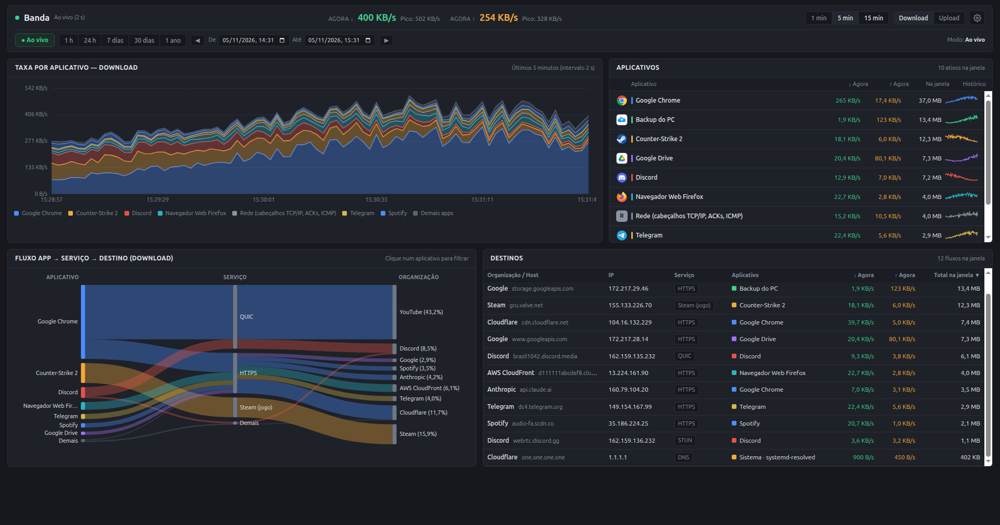
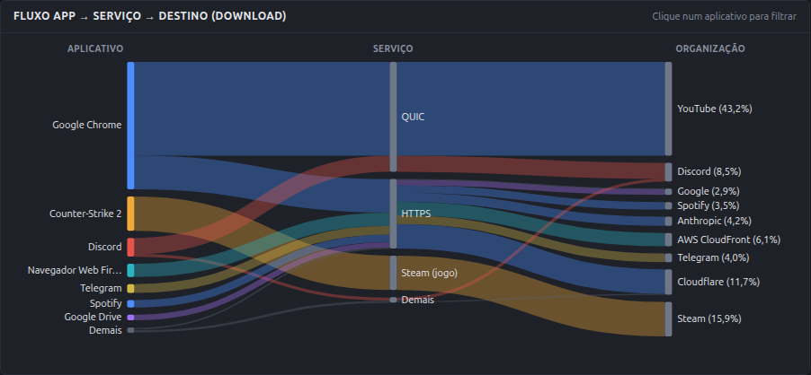
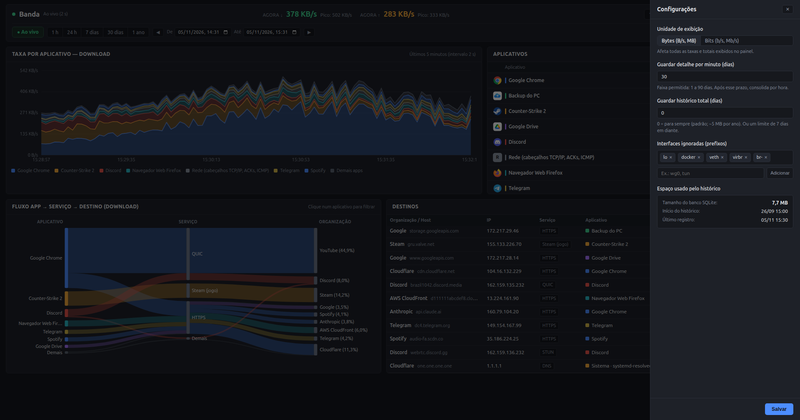
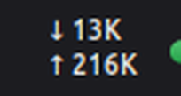

# Banda — Monitor de Rede por Aplicativo

**by [davicjc](https://davicjc.com)** · Linux (Mint, Ubuntu, Debian) · Licença AGPL-3.0

O **Banda** é um monitor de tráfego de rede para Linux que mostra, em tempo real e no histórico, quanto cada aplicativo está baixando e enviando e para quais servidores ou organizações na internet. Usa um coletor em C com eBPF CO-RE sempre ativo no kernel e uma interface web local sob demanda que só roda enquanto a janela está aberta.

## Prints









## Recursos

- **Monitoramento ao vivo (a cada 2 s)**: gráfico empilhado por aplicativo (janelas de 1, 5 e 15 minutos), lista de apps com ícone nativo do sistema e sparkline individual.
- **Identificação automática de programas**: aplicativos `.desktop`, pacotes Flatpak (`flatpak:<ID>`), jogos da Steam (`steam:<Jogo>`), montagens rclone (`nuvem:gdrive`, `nuvem:onedrive`, `nuvem:iclouddrive`), backups (`restic`), serviços do `systemd` (`svc:<serviço>`) e processos de vida curta (`comm:<nome>`).
- **Fluxo App → Serviço → Organização**: diagrama Sankey interativo e tabela ordenável com protocolo/porta (HTTPS, QUIC, DNS, SSH, Steam, STUN), IP, DNS reverso e organização.
- **Histórico em SQLite**: consulta rápida por período (1 h, 24 h, 7 dias, 30 dias, 1 ano ou intervalo de datas personalizado) com navegação temporal.
- **Applet para Cinnamon**: exibe a taxa atual de download e upload na barra do sistema e abre o painel em janela dedicada ao clicar.

## Como baixar e instalar

Leva uns 2 minutos. Você só precisa do **Terminal** (no Mint: menu → Terminal, ou `Ctrl+Alt+T`).

### Jeito 1 — um comando só (recomendado)

Copie a linha abaixo, cole no Terminal (`Ctrl+Shift+V`) e aperte Enter. Ele pede a sua senha do Linux:

```bash
sudo apt install -y git && git clone https://github.com/Davicjc/banda-monitor && cd banda-monitor && sudo ./instalar.sh
```

Pronto. Quando aparecer **"Instalação concluída!"**, o Banda já está funcionando.

### Jeito 2 — baixando o ZIP (sem git)

1. Nesta página, clique no botão verde **Code → Download ZIP**.
2. Extraia o ZIP (botão direito → *Extrair aqui*).
3. Entre na pasta extraída, clique com o botão direito num espaço vazio → **Abrir no terminal**.
4. Rode: `sudo ./instalar.sh`

### O que o instalador faz

Confere se o seu kernel é compatível, instala as ferramentas de compilação pelo repositório oficial da sua distribuição, compila o coletor, liga os serviços do `systemd`, coloca o **Banda** no menu de aplicativos e, no Cinnamon, coloca o medidor na barra de tarefas. Pode rodar de novo quando quiser: ele não quebra nada.

### Atualizar

```bash
cd banda-monitor && git pull && sudo ./instalar.sh
```

## Como abrir

- **Menu de aplicativos**: procure por **Banda — monitor de rede**.
- **Painel do Cinnamon**: clique no applet do Banda na barra (ou adicione-o em *Configurações → Applets → Banda — Monitor de Rede*).
- **Navegador**: acesse `http://127.0.0.1:7788/`.

Para testar a interface sem instalar e sem precisar de root (modo demonstração com dados simulados):

```bash
python3 teste/gerar-demo-db.py /tmp/banda-demo.db
python3 servidor/banda.py --demo --db /tmp/banda-demo.db --porta 7788
```

## Leveza

- **Coletor (`banda-coletor`)**: binário nativo em C + `libbpf` CO-RE sempre ativo em segundo plano, consumindo **~5 MB de RAM** e **~0% de CPU**.
- **Servidor da interface (`banda.py`)**: ativado sob demanda via `systemd` socket (`banda-monitor.socket`) apenas quando a janela é aberta, encerrando sozinho 60 segundos após fechar a janela.
- **Histórico compacto**: guarda os últimos 30 dias detalhados por minuto e consolida automaticamente o histórico anterior por hora (~5 MB por ano no SQLite).

## Privacidade

- **100% local**: todos os dados ficam na própria máquina (`/var/lib/banda-monitor/historico.db` e `/run/banda-monitor/agora.json`). Nenhuma telemetria ou consulta externa é enviada.
- **Acesso restrito à máquina local**: o socket HTTP escuta exclusivamente em `127.0.0.1:7788` e valida os cabeçalhos `Host`/`Origin` nas alterações de configuração.

## Configurações

Pelo botão de engrenagem no topo da janela (ou editando `/etc/banda-monitor/config.json`), é possível ajustar:

- **Unidade de exibição**: Bytes (`B/s`, `MB`, `GB`) ou Bits (`b/s`, `Mb/s`, `Gb`).
- **Retenção por minuto (`dias_minuto`)**: de 1 a 90 dias (padrão: `30`).
- **Retenção total (`dias_total`)**: `0` para manter para sempre (padrão) ou um limite em dias.
- **Interfaces ignoradas (`ignorar_interfaces`)**: prefixos de interfaces virtuais/locais ignoradas na soma da placa (padrão: `lo`, `docker`, `veth`, `virbr`, `br-`).

## Requisitos

- **Sistema operacional**: Linux Mint, Ubuntu ou Debian.
- **Kernel Linux**: ≥ 5.8 com BTF habilitado (`/sys/kernel/btf/vmlinux` presente — padrão nos kernels oficiais do Ubuntu, Debian e Linux Mint).

## Desinstalar

```bash
sudo ./desinstalar.sh
```

Para remover o programa mantendo o banco de histórico em `/var/lib/banda-monitor`:

```bash
sudo ./desinstalar.sh --manter-historico
```

## Arquitetura

A especificação técnica das sondas eBPF, formato do `/run/banda-monitor/agora.json`, regras de resolução de processos e esquema das tabelas SQLite está em [`docs/arquitetura.md`](docs/arquitetura.md).

## Licença e autor

**by davicjc** — criado por **Davi Castro** ([davicjc.com](https://davicjc.com) · [@Davicjc](https://github.com/Davicjc)).

Distribuído sob a licença **[GNU AGPL-3.0](LICENSE)**, a mesma do [Speed CJC](https://github.com/Davicjc/Speed-CJC): você pode usar, estudar, modificar e redistribuir à vontade, inclusive em empresa. Se distribuir uma versão modificada (ou oferecê-la para outras pessoas usarem pela rede), precisa publicar o código-fonte dela sob a mesma licença e manter o crédito ao autor original.
